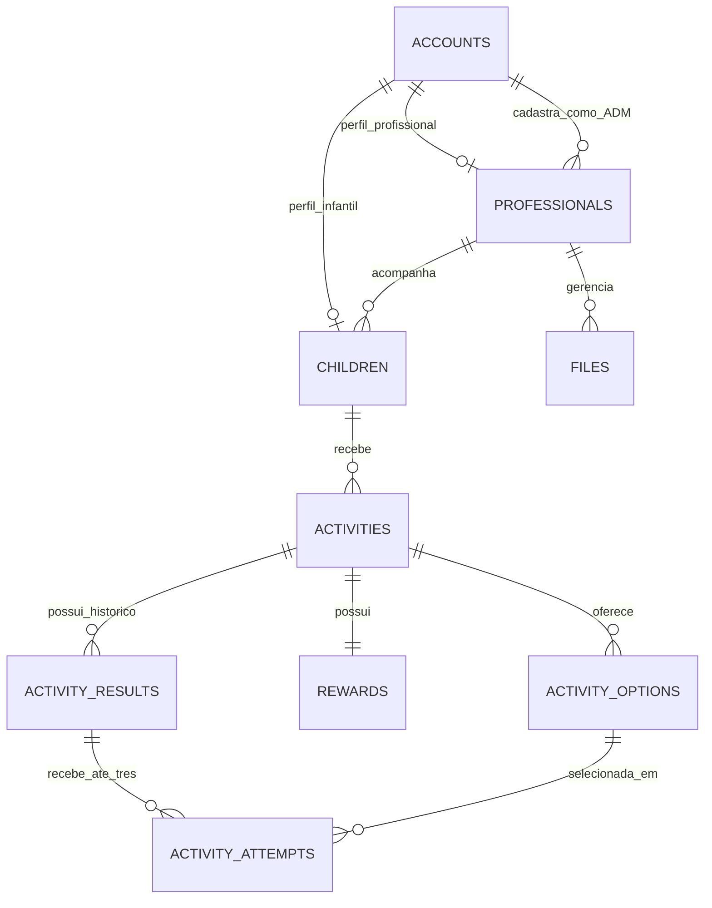

# Modelo de dados e permissões do Emotions

Status: esquema inicial aprovado, aplicado e validado no MySQL de desenvolvimento.
A unificação posterior foi aprovada e aplicada, preservando os campos e
o fluxo do banco antigo conforme orientação da desenvolvedora.
O desenho unificado tem nove tabelas de domínio e duas técnicas. A aplicação
foi validada e as permissões temporárias foram revogadas. As fixtures dos testes
foram revertidas, mantendo as tabelas de domínio vazias.
Nenhum dado antigo foi importado e o banco legado está preservado.

A [revisão física do esquema](../../backend/database/README.md) relaciona todos
os campos antigos às nove entidades do desenho unificado e diferencia garantias do banco de regras
transacionais ainda não implementadas. O desenho físico propõe `accounts`
compartilhado entre ADM, profissionais e crianças, mantendo login infantil,
sem duplicar a infraestrutura de credenciais.

## Regras confirmadas

- Um profissional acompanha várias crianças.
- Cada criança pertence a exatamente um profissional.
- Somente o ADM cadastra contas de profissionais; não há cadastro público de profissionais.
- O profissional cadastra cada atividade para uma criança específica sob seu acompanhamento.
- Não há atividades prontas fornecidas pelo sistema, catálogo compartilhado ou atribuição automática.
- Cada atividade tem exatamente uma recompensa.
- Cada execução de uma atividade permite no máximo três tentativas.
- O profissional responsável pode resetar uma atividade para liberar uma nova
  execução, sem apagar tentativas, tempos ou resultados anteriores.
- O reset só é permitido quando a última execução estiver finalizada, com
  acerto ou após três erros. Não pode interromper uma execução liberada ou em andamento.
- Após três respostas incorretas, exibir uma imagem carinhosa e mensagem de
  incentivo à continuidade, preservando o registro da execução.
- Medir o tempo de todas as tentativas e registrar o total por execução, sem prazo para responder.
- O fluxo infantil deve ser feliz, divertido e sem pressão por velocidade.
- O novo backend usa NestJS, TypeScript e Express, organizado por módulos.

As demais decisões deste documento são recomendações. Aprovar a documentação
não autoriza instalar pacotes, executar migrations ou alterar dados existentes.

## Referências do código anterior

| Origem em `_old/`                                        | Constatação                                                                                |
| -------------------------------------------------------- | ------------------------------------------------------------------------------------------ |
| `src/backend/models/Admin.js` e `Kid.js`                 | Não há associação entre profissional e criança.                                            |
| Migration `20211010100000-kids.js`                       | Não há chave estrangeira para o profissional; nascimento e campos de estado são textos.    |
| `src/backend/models/Task.js`                             | A atividade pertence a uma criança; alternativas ocupam três colunas.                      |
| `src/backend/models/Result.js` e migration de resultados | O model declara `kid_id`, mas a migration não o cria. `tries` também tem tipos diferentes. |
| Migrations de atividades, resultados e recompensas       | Há exclusões em cascata que podem remover registros relacionados.                          |
| `src/frontend/pages/PsycAcess/addKid/index.jsx`          | O formulário contém responsável, observações e um campo chamado “Grau”.                    |
| `src/frontend/pages/KidAcess/Task3/index.jsx`            | A duração é contada em segundos no cliente; há um fluxo de finalização.                    |

Os nomes `Admin` e `PsycAcess` se misturam no código anterior. A desenvolvedora
confirmou um papel ADM para cadastrar profissionais. Isso não concede
automaticamente acesso aos dados de todas as crianças.

### Conferência do comportamento antigo

| Regra                                                  | O que o código antigo executa                                                                                                                                      |
| ------------------------------------------------------ | ------------------------------------------------------------------------------------------------------------------------------------------------------------------ |
| Atividade criada pelo profissional para uma criança    | O formulário envia imagem, alternativas e `kid_id`; não há catálogo pronto nesse fluxo.                                                                            |
| Uma recompensa por atividade                           | O formulário solicita uma, mas a migration não torna `rewards.task_id` único nem obriga toda atividade a ter recompensa. A criação acontece em outra requisição.   |
| Recompensa após acerto                                 | O ramo de resposta correta em `KidAcess/Task3/index.jsx` chama `openReward()` e depois `sendTask()`.                                                               |
| Até três tentativas                                    | Não é aplicado. `tries` inicia em 1 e aumenta a cada erro, sem condição de encerramento na terceira tentativa. O backend aceita o contador informado pelo cliente. |
| Não repetir uma atividade finalizada                   | A interface avisa que não será possível refazer e a listagem consulta o estado, mas a chamada `updateTask()` está comentada no envio do resultado.                 |
| Tentativas preservadas ao recomeçar                    | Não. O botão de recomeço restaura `tries` para 1; o estado também está apenas no componente.                                                                       |
| ADM como único responsável por cadastrar profissionais | Existe uma tela administrativa, mas a rota de criação não verifica sessão nem permissão ADM.                                                                       |
| Um profissional por criança                            | Não há FK para representar o vínculo no esquema anterior.                                                                                                          |

O nome `Task3` e as três alternativas não constituem uma implementação do
limite de três tentativas. Ao errar, o fluxo também para o cronômetro e destaca
a alternativa correta. Esses comportamentos precisam de revisão no novo fluxo,
em vez de serem copiados como se garantissem as regras confirmadas.

## Relações propostas



Cada atividade é criada pelo profissional para uma criança específica. O
sistema não disponibiliza atividades prontas. Importações, seeds e demonstrações
não devem introduzir atividades reais automaticamente. A cardinalidade de
tentativas é de zero a três por execução; o diagrama não expressa sozinho esse
limite. A atividade é o conteúdo cadastrado; uma execução é uma oportunidade
de realizá-la, liberada pelo profissional.

### Administração — papel `administrator` em `accounts`

O papel ADM confirmado é representado em `accounts`, compartilhando a
infraestrutura de identidade, hash e estado de acesso com profissionais e crianças.
O cadastro profissional registra a conta ADM responsável por uma FK composta
com o papel, sem uma segunda tabela de credenciais administrativas.

Somente uma sessão autenticada com a permissão administrativa poderá criar
contas profissionais. A criação da primeira conta ADM exige um procedimento
explícito, sem usuário/senha padrão. A criação e ativação de outros ADMs e os
poderes de suspensão/recuperação ainda precisam de definição.

O papel ADM não deve herdar permissão de leitura de fotos, observações ou
resultados infantis apenas porque cadastra profissionais.

### Profissionais — `professionals`

- Identificador próprio, conta vinculada e conta ADM responsável pelo cadastro.
- Nome, usuário e hash ficam em `accounts`, sem duplicação no perfil.
- Usuário em minúsculas, sem espaços nas pontas, único com collation explícita
  `utf8mb4_0900_as_ci`. A implementação de autenticação deve respeitar essa política.
- Estado de acesso na conta, arquivamento no perfil e datas de criação/alteração.
- Nenhum retorno da API deve incluir o hash da senha.

O cadastro será feito exclusivamente pelo ADM. A operação deve registrar o
administrador responsável. Profissionais não podem criar outras contas
profissionais, e o frontend não oferecerá cadastro público.

Entrega do primeiro acesso, ativação e recuperação de senha ainda precisam
de definição. E-mail e número de registro profissional não serão coletados
automaticamente apenas porque poderiam ser úteis no futuro.

### Crianças — `children`

- `professional_id`: chave estrangeira obrigatória, com índice para consultas.
- Nome, usuário e hash em conta com papel infantil, preservando o fluxo antigo
  conforme orientação da desenvolvedora; segurança da autenticação será implementada
  na etapa própria.
- Nascimento como data civil (`DATE`), sem conversão de fuso horário.
- Nome do responsável e observações com limites explícitos, quando necessários.
- Foto como referência a um arquivo protegido, nunca como URL pública fixa.
- Datas de criação/alteração e estado de arquivamento.

Campos opcionais devem aceitar ausência real, sem exigir strings vazias ou
conteúdo inventado para satisfazer o banco. Nascimento e responsável foram
mantidos obrigatórios; observações, grau informado e foto aceitam ausência real.

O campo antigo `rate` não será convertido automaticamente em classificação
clínica. Seus valores e sua necessidade precisam ser revisados. Também não se
deve confundir o campo `treatment` com permissão para autenticar. Dados antigos
serão preservados até uma decisão explícita sobre seu destino.

### Atividades — `activities`

- `child_id`: chave estrangeira obrigatória.
- Nome, emoção trabalhada, imagem protegida e estado controlado.
- Datas de criação/alteração.
- Estados de conteúdo propostos: `draft`, `published`, `archived`.

O profissional só pode criar atividades para suas próprias crianças. Cada
atividade deve ser cadastrada especialmente para sua destinatária, incluindo
suas alternativas e recompensa. Não haverá conteúdo pronto do sistema.

Uma atividade só pode ser publicada quando suas alternativas, recompensa e
referências forem válidas. A disponibilidade para a criança depende também
de uma execução liberada. A conclusão pertence à execução, não apaga a
atividade e não é um estado que o cliente possa atribuir livremente.

### Execuções e reset — `activity_results`

- `activity_id` obrigatório; número sequencial único por atividade.
- Unicidade de `(id, activity_id)` para referências compostas das tentativas.
- Estados propostos: `ready`, `in_progress`, `completed`.
- Registro do profissional que liberou a execução e das datas de início/encerramento.
- Registro da operação de reset e do profissional responsável por liberar a repetição.
- No máximo uma execução aberta (`ready` ou `in_progress`) por atividade.

A primeira execução é liberada na publicação. O reset autorizado libera uma
nova execução da mesma atividade, para a mesma criança, com até três novas
tentativas e sua própria medição de tempo. Não cria outra atividade nem outra
recompensa, e não muda a titularidade da criança.

O reset exige que a última execução esteja em `completed`, com resultado
`correct` ou `attempts_exhausted`. Seu desfecho permanece intacto. Se houver
execução em `ready` ou `in_progress`, o reset é rejeitado sem alterar dados.
O profissional não pode usar esse controle para interromper a criança,
zerar tentativas em andamento ou finalizar uma execução artificialmente.

A operação deve ocorrer em transação, com autorização do profissional da
criança e bloqueio da atividade. Registrar a operação de reset de forma
idempotente para que um duplo clique ou reenvio não libere duas execuções.
O pedido identifica a execução finalizada que será repetida. Um reenvio da
mesma operação devolve a nova execução já criada. Uma operação diferente
baseada em uma execução antiga ou enquanto houver outra aberta deve ser
rejeitada como conflito de estado, sem liberar repetições adicionais.
A unicidade da execução aberta também precisará de garantia compatível com
o MySQL escolhido; não basta consultar e inserir sem proteção concorrente.

Uma resposta atrasada referente à execução já finalizada não pode ser gravada
na nova execução. O envio da criança inclui o identificador da execução,
validado pelo servidor junto com a atividade e o escopo autenticado.

Na área profissional, o controle pode ser apresentado como “Liberar repetição”,
com explicação de que o histórico será preservado. O acesso da criança não
terá permissão de reset e não haverá reset automático ao voltar à página.
O botão só fica habilitado após a finalização, mas a mesma condição é validada
no servidor para impedir chamadas diretas que contornem a interface.

Recomendação para proteger o significado do histórico: conteúdo, alternativas,
recompensa e feedback ficam imutáveis após o início da primeira execução. Se
o profissional quiser mudar o conteúdo, cadastra uma nova atividade. O reset
repete o conteúdo existente; versionamento de conteúdo poderá ser avaliado
se essa edição posterior se tornar um requisito.

### Alternativas — `activity_options`

- `activity_id`, texto, posição e indicador de resposta correta.
- Unicidade de `(activity_id, position)`.
- Unicidade de `(activity_id, id)` para referências compostas das tentativas.
- Posição limitada a 1, 2 ou 3 nesta primeira versão, preservando a interação antiga.

Proposta: manter exatamente três alternativas e uma correta ao publicar a
atividade. Contagens entre linhas serão validadas pelo serviço em transação,
com bloqueio da atividade durante mudanças concorrentes. Uma restrição simples
de coluna não garante essas contagens. Escritas administrativas e importações
também precisarão respeitar esse fluxo.

O indicador de resposta correta não será enviado antecipadamente na listagem
das atividades da criança. A validação de resposta deve ocorrer no servidor.

### Recompensas — `rewards`

- Exatamente uma recompensa por atividade: `activity_id` obrigatório e único.
- Mensagem em texto, com limite de tamanho; imagem protegida quando utilizada.
- A recompensa pertence ao mesmo contexto da atividade.

A imagem não deve ser globalmente única: um recurso pode ser reutilizado
dentro do escopo autorizado. Mensagens não serão tratadas como HTML livre.

Atividade e recompensa serão criadas na mesma transação, inclusive ao salvar
um rascunho persistido. A recompensa não poderá ser removida isoladamente,
deixando a atividade sem recompensa. A chave única garante no máximo uma;
a existência obrigatória precisa ser garantida pelo fluxo transacional e
verificada também em importações. Não confundir uma FK com garantia das duas
direções de uma relação um para um.

O código antigo exibe a recompensa no ramo de acerto. A proposta mantém essa
distinção: no acerto, exibir a recompensa; ao terminar três tentativas sem
acerto, exibir o acolhimento descrito abaixo. A recompensa continua cadastrada
e vinculada à atividade, sem ser apagada.

### Acolhimento ao encerrar sem acerto

A desenvolvedora definiu que, depois de três erros, deve aparecer uma imagem
fofa com uma mensagem carinhosa e pedagógica, incentivando a continuidade.
Não se deve deixar a criança sem retorno nem usar linguagem de derrota.

Exemplo de texto para revisão:

> Cada descoberta tem seu tempo. Vamos continuar aprendendo juntos na próxima atividade?

Esse acolhimento é um feedback de encerramento, distinto da recompensa de
acerto. Ele não cria uma segunda recompensa na relação atividade → recompensa.
A atividade e seu histórico permanecem disponíveis ao profissional.

Recomendação de configuração: o profissional escolhe a imagem e a mensagem
desse encerramento junto com a atividade. A origem desse conteúdo será
confirmada antes do esquema final, preservando a orientação de não fornecer
atividades prontas pelo sistema. Não criar uma biblioteca automática sem aprovação.

Na interface, o feedback deve ter texto acessível e uma ação clara para
continuar, sem fechamento automático, som inesperado ou animação piscante.
O limite de tentativas não deve ser apresentado como perda de vidas ou punição.

### Tentativas — `activity_attempts`

- Uma linha por resposta avaliada, vinculada à execução e à alternativa escolhida.
- Número da tentativa limitado a 1, 2 ou 3.
- Unicidade de `(result_id, attempt_number)`.
- Referência composta de realização/atividade para impedir que uma tentativa
  associe a execução de uma atividade ao identificador de outra.
- Referência composta `(activity_id, selected_option_id)` para impedir seleção
  de alternativa pertencente a outra atividade.
- Identificador da operação para reconhecer reenvios, sem contar a mesma
  resposta duas vezes por falha de rede.
- Horário da avaliação e resultado calculados pelo servidor.
- Início, resposta e duração de cada tentativa, para não perder a medição
  quando houver erro ou quando uma segunda/terceira tentativa for necessária.

Proposta de avaliação: bloquear a atividade e sua execução aberta na transação,
verificar autorização, estado e quantidade de respostas já registradas naquela
execução e só então inserir a próxima tentativa. O cliente não escolhe o número
da tentativa nem envia um contador confiável. A combinação de unicidade e
limite no banco protege o teto de três por execução; a sequência, a concorrência
e a regra de parada são verificadas pelo serviço.

Atualizar a página, sair e entrar ou abrir duas abas não restaura tentativas.
Reenviar a mesma operação deve devolver a avaliação já registrada. Uma nova
operação depois do limite deve ser rejeitada sem criar uma quarta linha.

Uma resposta correta encerra a execução antes do limite e libera a recompensa.
Sem acerto, a terceira avaliação encerra a execução, registra o desfecho e
mostra a imagem e a mensagem de incentivo. Não há quarta tentativa na mesma
execução nem reinício automático por atualização da página, saída ou reenvio.

O profissional consegue consultar o registro; a criança recebe acolhimento.
O código antigo não implementa esse desfecho específico para três erros.

### Medição sem pressão de tempo

- Registrar a duração individual de cada tentativa, incluindo a que termina em erro.
- Registrar a duração de cada execução como soma das durações das suas tentativas,
  sem dupla contagem. Um reset não altera os tempos das execuções anteriores.
- Não misturar o tempo de várias execuções em um único resultado. O profissional
  poderá consultar o histórico individual das repetições.
- Erro não encerra definitivamente a medição: a tentativa seguinte também é medida.
- Não há prazo máximo, contagem regressiva ou reprovação por demora.
- Recomenda-se que o tempo fique somente no acompanhamento do profissional,
  sem cronômetro na tela da criança, ranking ou pontuação por velocidade.
- Uma falha de rede ou expiração da sessão não pode ser tratada como resposta
  errada nem consumir uma tentativa. A segurança da sessão tem política própria,
  sem transformar a duração do exercício em um prazo de desempenho.
- Definir como pausas e períodos fora da tela entram na medição antes de
  implementar o cronômetro. Distinguir tempo decorrido de tempo ativo e manter
  a origem da medição explícita no registro do profissional.

### Registro unificado da realização e desfecho — `activity_results`

A desenvolvedora aprovou unificar o acompanhamento e o resultado final em uma
única tabela chamada `activity_results`. Cada linha existe desde a liberação, guarda
estado, início, conclusão e `outcome` nulo enquanto estiver aberta. Ao concluir,
`outcome` é obrigatório: `correct` ou `attempts_exhausted`.

Cada repetição cria outra linha da mesma atividade e referencia a anterior,
sem apagar tentativas ou desfechos. `activity_attempts.result_id` identifica
exatamente a realização respondida. Quantidade de tentativas e duração total
são calculadas das linhas desse mesmo registro, sem armazenar totais duplicados.
A última tentativa preservada identifica a resposta final.

O serviço deve validar escopo, estado, sequência, limite, acerto e finalização
na mesma transação. O esgotamento requer três erros; o banco não conta linhas
filhas por CHECK. Reenvios e finalizações conflitantes não podem sobrescrever
o histórico. O profissional só libera repetição após a conclusão, nunca durante
uma realização aberta. Contadores e tempos do cliente não são confiáveis por si.


### Arquivos — `files`

- Identificador, `professional_id`, chave interna de armazenamento, tipo e tamanho.
- Chaves geradas pelo servidor; nome original não define caminhos no disco.
- Conteúdo fora de diretório público, com entrega após autorização.
- O vínculo do arquivo a uma criança, atividade ou recompensa precisa pertencer
  ao mesmo profissional. Não basta aceitar um identificador enviado pelo cliente.

Upload e associação precisam prever falhas e limpeza de arquivos órfãos. A
exclusão de um registro não deve apagar um arquivo ainda referenciado. Nenhuma
foto existente em `_old/` será importada, publicada ou apagada automaticamente.

## Tipos, integridade e histórico

- Identificadores e chaves estrangeiras terão tipos consistentes em todas as tabelas.
  O formato final será escolhido junto com o esquema e o ORM, sem tratá-lo como autorização.
- Datas de eventos em UTC; nascimento como data civil.
- Estados controlados, sem variações como “realizada” e “Não realizada” espalhadas.
- Índices nas chaves de consulta, especialmente profissional → crianças e criança → atividades.
- Restrições de nulidade, unicidade e referência também no banco, além dos DTOs.
- Verificar versão e recursos do MySQL antes de contar com restrições `CHECK`.
- Evitar exclusão em cascata de dados pessoais e resultados. Proposta inicial:
  arquivamento e bloqueio de exclusão física de registros referenciados.
- Arquivar não equivale a apagar. Retenção, remoção definitiva e restauração
  precisam de regras próprias, aprovadas antes de uma operação destrutiva.
- Transferir uma criança de profissional é uma operação privilegiada ainda não
  definida; não será permitida por um `PATCH` genérico de cadastro.

## Permissões propostas

| Operação                            | Profissional autenticado                                          | Criança autenticada                              |
| ----------------------------------- | ----------------------------------------------------------------- | ------------------------------------------------ |
| Consultar perfil                    | Próprio                                                           | Próprio, com campos mínimos                      |
| Consultar crianças                  | Somente as vinculadas a ele                                       | Não pode listar crianças                         |
| Criar/editar cadastro infantil      | No próprio escopo                                                 | Não permitido                                    |
| Criar/editar atividade e recompensa | Para suas crianças, respeitando estado e histórico                | Não permitido                                    |
| Consultar atividade                 | De suas crianças                                                  | Somente as próprias, liberadas para execução     |
| Responder/finalizar atividade       | Sem impersonação automática da criança                            | Somente a própria atividade disponível           |
| Resetar/liberar repetição           | Para suas crianças, apenas após finalização e sem execução aberta | Não permitido                                    |
| Consultar resultados                | De suas crianças                                                  | Somente retorno necessário ao fluxo da atividade |
| Consultar arquivo                   | De recurso autorizado no próprio escopo                           | Apenas os necessários à própria atividade/perfil |
| Alterar vínculo de profissional     | Operação separada ainda não definida                              | Não permitido                                    |

Autenticação identifica o ator. Autorização limita o que ele pode fazer.
Ocultar um botão no frontend não substitui nenhuma dessas verificações.

| Operação administrativa              | ADM autenticado               | Profissional              | Criança                 |
| ------------------------------------ | ----------------------------- | ------------------------- | ----------------------- |
| Cadastrar profissional               | Permitido                     | Não permitido             | Não permitido           |
| Consultar dados infantis por ser ADM | Não concedido automaticamente | Somente no próprio escopo | Somente o próprio fluxo |

Suspensão, ativação, recuperação de contas e criação de outros ADMs serão
especificadas antes da implementação desses endpoints.

### Aplicação do escopo

O profissional vem da sessão autenticada, nunca de um campo livre no corpo ou
na URL. O serviço consulta o recurso dentro desse escopo. Exemplo conceitual:

```sql
SELECT activities.*
FROM activities
JOIN children ON children.id = activities.child_id
WHERE activities.id = :activity_id
  AND children.professional_id = :authenticated_professional_id;
```

Os valores serão vinculados por parâmetros; este exemplo não é uma migration
nem uma consulta para interpolar strings. Filtragem por escopo deve alcançar
listagem, contagem, leitura individual, escrita, resultados e entrega de arquivos.

Um recurso inexistente e um recurso pertencente a outro profissional devem
produzir a mesma resposta pública de não encontrado. Tentativas de escrita
também precisam de condição de escopo e verificação de linhas afetadas.
Alterações concorrentes não podem contornar a autorização.

## Persistência de autenticação aprovada e aplicada

A terceira migration adicionou sessões, tokens profissionais e limites de acesso,
com o hash anulável somente em contas não ativas. A entrega manual de links pelo
ADM foi aprovada: ativação em 24 horas e recuperação em 30 minutos. O esquema
aplicado tem doze tabelas da aplicação e duas técnicas, validado no MySQL local.
Os [campos, restrições e limites de validação](authentication.md#4-persistência-aplicada-e-validada)
estão documentados. O incremento seguinte implementou login adulto, sessão e
logout com CSRF e limites compartilhados, sem alteração adicional de esquema.

## Cadastro profissional e primeiro acesso — implementação na API

Cadastro exclusivo do ADM, reemissão e ativação usam as contas, perfis e tokens
existentes. A conta nasce pendente e sem senha, e só é ativada no consumo único
do link de 24 h. As transações preservam os registros de convites anteriores.
O [desenho de onboarding](professional-onboarding.md) registra contratos,
locks, proteção contra concorrência e limitações. Não houve mudança de esquema.

## Direção proposta para autenticação

O [desenho de autenticação](authentication.md) detalha a proposta de hash nativo,
primeiro ADM, ativação, sessões e recuperação, com decisões ainda em revisão.

- Senhas e códigos nunca em texto simples; algoritmo, parâmetros e política
  de credenciais são detalhados no desenho de autenticação; Argon2id e criação
  local do primeiro ADM estão implementados, com os demais fluxos ainda em revisão.
- Não reutilizar automaticamente as credenciais antigas nem criar contas padrão.
- Preferência inicial por sessões revogáveis no servidor e cookie `HttpOnly`,
  com `Secure` em HTTPS e política `SameSite` adequada ao ambiente.
- Definir expiração, revogação, proteção contra CSRF e limite de tentativas.
- Não guardar tokens de sessão em `localStorage` ou expor hashes nas respostas.
- O acesso infantil deve ser restrito ao próprio fluxo e depender da conta
  ativa do profissional responsável. Código curto não será tratado como segredo forte.
- A criação de profissionais é exclusiva do ADM; não haverá cadastro público.
  Recuperação e primeiro acesso dependem do fluxo a aprovar.

## Plano de migração e evidências necessárias

1. Aprovar as regras e selecionar a integração de persistência.
2. Conferir a versão do MySQL e preparar um ambiente isolado para testes.
3. Propor migrations revisáveis, sem sincronização destrutiva automática ao iniciar.
4. Testar chaves estrangeiras, nulidade, unicidade e transações no MySQL real.
5. Testar profissional A tentando acessar cada recurso do profissional B.
6. Testar sessões inválidas, finalização duplicada e referências entre atividades diferentes.
   Verificar também o teto de três tentativas sob concorrência e reenvios,
   a recompensa obrigatória e a rejeição do cadastro profissional sem permissão ADM.
   Conferir o feedback carinhoso no terceiro erro e a medição de todas as
   tentativas, inclusive após erro, sem encerramento por demora.
   Testar reset autorizado e não autorizado, preservação do histórico, duplo
   clique, pedido baseado em execução antiga e corrida entre reset e envio de
   resposta. O reset antes da finalização deve ser rejeitado. Nenhuma resposta
   da execução anterior pode consumir uma tentativa da nova.
7. Planejar a atribuição dos registros antigos a seus profissionais. A origem
   não contém esse vínculo; não atribuir todos os registros à primeira conta.
8. Preservar dados e arquivos até a revisão e autorização da migração efetiva.

## Decisões pendentes

- Como criar o primeiro ADM, entregar o primeiro acesso e ativar/recuperar contas?
- Detalhar o acesso infantil preservado do fluxo antigo, com credencial protegida
  e sem tratar códigos curtos como segredo forte.
- Confirmar se o profissional configura também a imagem e a mensagem de acolhimento.
- Definir a contabilização de pausas e períodos fora da tela, sem impor prazo de resposta.
- Definir retenção e exposição dos campos infantis preservados. O esquema mantém
  `rate` como informação declarada e `treatment` como booleano de tratamento ativo,
  sem converter nenhum deles automaticamente em diagnóstico ou permissão de acesso.
- Como tratar arquivamento, retenção, transferência e exclusão definitiva?

Essas pendências não alteram as regras confirmadas de vínculo, criação das
atividades, recompensa obrigatória, cadastro pelo ADM, teto de três tentativas
por execução e reset pelo profissional somente após finalização, com
preservação do histórico.

## Referências de segurança

- [OWASP — autorização por requisição e por recurso](https://cheatsheetseries.owasp.org/cheatsheets/Authorization_Cheat_Sheet.html).
- [OWASP — sessões, cookies e armazenamento do token](https://cheatsheetseries.owasp.org/cheatsheets/Session_Management_Cheat_Sheet.html).
